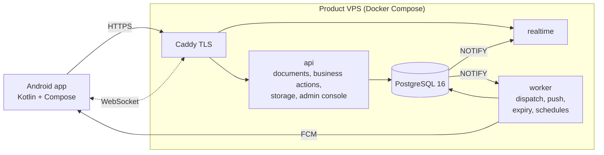

# Mingalarpar Taxi: Multi-Role Ride-Hailing App, Engineering Case Study

> A ride-hailing platform live in production for customers, drivers and staff, with vehicle classes, an SOS channel, a coin rewards economy and automatic order recovery.
> Its backend is **callme-core**, the self-hosted platform designed for [Call Me Taxi](https://github.com/ywtzdev/callme-taxi-showcase), extended with Mingalarpar's own product rules, on its own server.

This repository is the **public case study** of the project: product scope, architecture, and the rules that make dispatch and money safe. The application and backend source are private. Qualified reviewers can ask for a guided code walkthrough.

---

## At a glance

| | |
|---|---|
| Users and data (Nov 2026) | 738 accounts, 703 driver profiles, 6,365 orders, 3,505 trips, 233,044 records in 39 collections, 879 media files |
| Android app | about 330 Kotlin files, Jetpack Compose, 2 languages, 3 role families (customer, driver, staff) |
| Server rules | 9 server-side services: business actions (~115), settlement, push, alerts, dispatch control, order expiry (scheduler, worker, watchdog), top-up guard |
| Platform | callme-core: Node.js 22, PostgreSQL 16 + PostGIS, WebSocket realtime, durable job queue, 66 shared backend modules enforced byte-identical with the sister product, one dedicated VPS per product |
| Verification | 241 Android unit tests; 83+ backend tests on real PostgreSQL; **42-check customer POV end-to-end suite** (register → approval → fare → booking → nearest driver → accept → tracking → cancel fees → SOS → delete → re-register); **80-order continuous FCM/realtime audit** (0 failed, 0 suppressed, 0 dead jobs); 200-driver load test with 0 errors |

---

## Product features that set it apart

- **Vehicle classes.** Drivers declare their class once (EV or standard) and the lock is server-enforced. Customers pick a class with a transparent surcharge, and dispatch offers an order only to matching vehicles.
- **SOS channel.** Riders and drivers can raise an emergency. Staff get a dedicated red banner and an alarm-grade notification, with an acknowledgement ledger so no alert is silently lost.
- **Coin rewards.** Every coin movement goes to a ledger. Redemption has a threshold and staff approval, and redeem codes and admin tools sit on the same idempotent finance path as wallet operations.
- **Automatic order recovery.**
  - An order nobody accepts within **3 minutes** is frozen automatically.
  - A customer order waiting for staff review moves to citywide dispatch after **30 s**.
  - Both are race-safe: a driver accepting at the same moment always wins (see [docs/DISPATCH_AND_RECOVERY.md](docs/DISPATCH_AND_RECOVERY.md)).
- **Server-owned dispatch settings.** Staff tune ring timing (1–30 s) and the staff-review window from the app. Values are validated and stored on the server, not in the phone.
- **Scheduled orders.** Bookings for later get reminders 30 and 20 minutes before pickup, through chat and push, with delivery recovery if a reminder is missed.
- **Wallets.** Driver and customer wallets with top-up review, direct deposit and withdrawal, transfers and low-balance alerts. All are server-authoritative and replay-safe.

---

## Architecture

- Mingalarpar runs the **same platform code** as Call Me with its own database, Firebase project, settings and server rules. Each product gets its own VPS and domain, so an incident in one product cannot touch the other.
- Product-specific rules (vehicle classes, coins, SOS, expiry) plug into the same transaction, session and policy framework.

Details: [docs/ARCHITECTURE.md](docs/ARCHITECTURE.md).

---

## Engineering highlights

- **Race-safe automation.** The 3-minute auto-freeze stages its write inside a transaction that also read the order. If a driver accepts in between, the commit fails with a conflict and the freeze is abandoned, never overwritten. A once-a-minute watchdog re-checks only bounded pages of candidates, so a lost timer cannot strand an order.
- **Evidence-based audit of every server service.** Every deployed server function was exported, hashed and compared with the repository. The audit found a production service that had been **silently failing**: the top-up identity guard addressed a stale project id, so every call was rejected with 401 ([docs/ENGINEERING_CASE_STUDY.md](docs/ENGINEERING_CASE_STUDY.md)).
- **A measured comparison with the sister app.** Source trees were diffed with package names normalised: 57 identical files, 203 diverged (about 25,000 changed lines), 71 Mingalarpar-only files. The diff produced a porting plan: shared fixes are re-applied deliberately, product modules stay separate.
- **Security baseline** on the product server:
  - firewall with only 22/80/443 open;
  - fail2ban, which banned its first brute-force IP within seconds;
  - secrets entered only through hidden prompts and stored root-only;
  - read-only, least-privilege export keys.

## November 2026: what the customer-side audit changed

A scripted run through everything a customer can do found rules that did not match the owner's intent, and each was fixed and re-verified:

- **SOS** was refused until the car had moved 100 m; it now works from the moment a driver has accepted and lands in the staff support chat.
- **Delete** now really deletes (it used to archive), so the phone number can be used again, while a permanent ban survives deletion. Deleted User IDs are never reused, so a new customer can never inherit someone else's rides or wallet ledger.
- **One live account per phone**, recognised in any format, for customers and drivers alike.
- **The newest sign-in wins**: signing in on a new phone signs the old one out instead of locking the account.
- **The terms screen** no longer needed a manual refresh before "Accept" unlocked (a cancelled duplicate load overwrote the fresh one).

---

## November 2026: two companies, one network

- **Cross-company order transfer with commission settlement.** A driver or staff member can hand an unaccepted order to the sister company. The original company fixes the commission by its own rules and sends it with the order; the accepting driver pays it from their wallet exactly as for a local order and collects it in the fare. A driver who created the order is credited at once; for staff orders the commission is kept as a record. Both companies keep a mirrored ledger, and settlement nets the two directions while storing the original totals next to the net. An Admin of each company must approve; Super Admins can only view.
- **Money over an unreliable link.** Companies talk over an HMAC-signed, replay-protected peer link with an ordered outbox: a peer outage delays a message but never loses or doubles money, and a settlement the other side cannot match exactly is refused and released.
- **Verified with both real backends.** A simulation boots both companies' real code against a temporary PostgreSQL and drives transfers, wallets, settlement and re-delivered messages through the signed link.
- **Edge network.** Traffic now enters through a CDN/WAF edge. The servers accept web traffic only from the edge, the real client IP is restored for rate limits, and health checks verify the origin certificate directly. This also fixed riders whose mobile network could not reach the server address.
- **Worst-case burst test.** 200 drivers online with live sockets and GPS; at the same instant 30 app orders, 50 manual trips and 20 customer bookings, each driven to the end of the trip, on a scratch copy of production data. It found three problems, now fixed: order-number allocation retried itself into failures (now taken in turns), dispatch jobs waiting between waves used up the worker slots (12 → 48), and a 15 s socket timeout dropped queued requests.
  - Mingalarpar: **100 of 100 flows completed, 0 errors**; app orders accepted after ~28 s median, which includes the deliberate 30 s staff window. The live system stayed responsive during the test (~0.2 s median).

---

## Late November 2026: push reliability, live admin escalation & cross-company distance dispatch

- **80-order continuous push & realtime audit.** Audited 40 app orders and 40 customer bookings end-to-end (offer, accept, private chat, cancel, complete) against an isolated scratch stack with a push capture sink. Found and fixed production push issues including instant recipient-cache version invalidation on fresh login, sequential-offer expiry timestamps (`offerExpiresAt`), chat message type propagation, pending cancel/freeze bystander popup dismissal, and atomic cross-account `fcmToken` ownership — post-fix audit: **0 failed pushes, 0 worker errors, 0 suppressed recipients**.
- **One-tap live Admin escalation in Private Chat.** Drivers and customers can tap *Connect with Admin* inside any active trip chat. Super Admin, Admin, and Monitor receive an FCM alert, a Notification Center entry, and a live **Support Chat** escalation inbox backed by an active-trip join — staff can participate live in both local and transferred trip chats, and escalations clear automatically as soon as the trip completes or cancels.
- **Cross-company Distance Order transfer.** Distance orders transferred between Mingalarpar and Call Me now carry pickup coordinates and execute under **the receiving company's own** distance ring rules (`D1–D7` with open-order continuation guards and vehicle-class normalization on Mingalarpar), while cleanly dismissing stale offers on the originating side.
- **Universal cancellation finance & arrival lock.** Unified order cancellation settlement (*No Fee*, *2,000 Ks driver compensation*, *commission deduction*) with a dedicated transfer penalty ledger and server-enforced arrival/departure locks.
- **Edge mTLS, Notification Bell audit & Compose smoothness.** Hardened Caddy with **Cloudflare Authenticated Origin Pulls (mTLS)** and IPv6 origin firewalling; fixed Notification Bell cold-start deep links, phantom unread badges, and `chat_bell` TTL/sound/brand parity; refined Jetpack Compose media decoding and recomposition responsiveness (241 Android unit tests passing).

---

## Repository guide

| Document | What it covers |
|---|---|
| [ARCHITECTURE.md](docs/ARCHITECTURE.md) | Platform, product modules, data, deployment |
| [DISPATCH_AND_RECOVERY.md](docs/DISPATCH_AND_RECOVERY.md) | Staff review, rings, vehicle classes, 3-minute auto-freeze, watchdog |
| [ENGINEERING_CASE_STUDY.md](docs/ENGINEERING_CASE_STUDY.md) | Audit findings and design decisions |
| [MIGRATION.md](docs/MIGRATION.md) | Moving a live product onto its own backend safely |
| [SECURITY.md](SECURITY.md) | What this public repository deliberately does not contain |

Platform design, security model and production incidents are documented in the [Call Me Taxi case study](https://github.com/ywtzdev/callme-taxi-showcase).

---

© 2026. Portfolio material, see [LICENSE.md](LICENSE.md). The production application and backend are proprietary.
